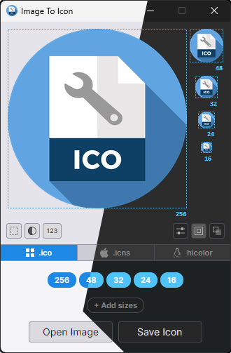

# ImageToIcon

<p align="center">
<a href="https://dotnet.microsoft.com/download"></a>
<a href="https://learn.microsoft.com/dotnet/csharp/"></a>
<a href="https://avaloniaui.net/"></a>
<a href="https://distrochooser.de/"></a>
<a href="LICENSE.txt"></a>
</p>
<p align="center">
<a href="../../issues"></a>
<a href="../../commits/master"></a>
<a href="../../releases/latest"></a>
</p>

**ImageToIcon** is a small cross-platform tool for turning any image into a multi-size Windows `.ico` file. Drop in a single picture and it generates all the standard icon sizes at once, with clean Lanczos downscaling — no wizard, no upsell, no bundle of proprietary editors.

> Every icon workflow used to mean juggling three tools: one to resize, one to compose, one to export. ImageToIcon collapses that into one window and one save button.

---

## Preview (light / dark)
<p align="center"><a href="media/"></a></p>

---

## Features

- Runs natively on Linux and Windows — same binary logic, same output
- Exports Windows `ICO`, macOS `ICNS` and Linux hicolor icon trees (as folder or `.tar.gz` archive)
- Load any common raster format: `PNG`, `JPG`, `BMP`, `DIB`, `TIF`, `GIF`, `WEBP`, `TGA`, `QOI`, `PBM`/`PGM`/`PPM`/`PNM`
- Load `SVG` files directly (rasterised via Skia) and extract icon frames straight from `ICO`, `ICNS`, `EXE` and `DLL` files
- Default preset covers the standard Windows application icon sizes (256, 48, 32, 24, 16); separate defaults for `ICNS` and hicolor
- Freely add, edit or remove custom sizes — any value from 2&nbsp;px up to 4096&nbsp;px, right-click a size to manage it
- High-quality Lanczos-3 resampling for sharp results at every size
- Corner radius slider — round the icon from soft corners all the way to a full circle mask
- Padding slider — shrink the content inside the frame to taste
- Background color picker with an eyedropper to sample from any existing thumbnail
- Shadow effect with color, X/Y offset and blur, optionally wrapping the background
- Stroke effect with color, width and an inner/outer offset slider, optionally wrapping the background
- Testing mode — preview icons flat, and strip the background from the saved file in one click
- Per-thumbnail fit mode (Fit, Stretch or Crop) with mouse-wheel zoom and right-click drag to pan
- Any size can use its own source image — drop a hand-tuned 16&nbsp;px or 32&nbsp;px onto that slot and it is used only for that size, while all others keep rendering from the main image
- Drag-and-drop support on the main window and on individual thumbnails
- CLI mode exposing the full set of shape, background and effect options for batch conversion and scripting
- Settings persist between sessions — selected sizes, formats, corner, padding, shadow and stroke
- `PNG`-compressed frames inside the `ICO` and `ICNS` containers for smaller files, especially at 256&nbsp;px and up

---

## Download

The latest release is available on the [Releases](https://github.com/koryboc/ImageToIcon/releases/latest) page — no installation required, just extract and run the executable — *ImageToIcon.exe* on Windows, *ImageToIcon* on Linux.

---

## Command Line

ImageToIcon also runs headless. Any invocation containing `--cli` skips the UI and processes files directly:

```bash
ImageToIcon --cli --o=./out image1.png image2.jpg
ImageToIcon --cli --o=./out --sizes=16,32,48,256 logo.png
```

Run `ImageToIcon --help` to see the full list of options, including format, corner, padding, background and effect flags.

| Option | Description |
| --- | --- |
| `--cli`, `/cli` | Run in CLI mode. |
| `--o=DIR`, `/o=DIR` | Output directory for the generated `.ico` files. |
| `--sizes=<list>` | Comma-separated list of icon sizes to generate (2–4096). |
| `--help`, `/?` | Show usage information. |

---

## Requirements

### Linux
- Any modern x64 Linux distribution
- No .NET runtime required — ships as a self-contained single-file executable

### Windows
- Windows 10 or later (x64)
- No additional dependencies — ships as a self-contained single-file executable

### Other platforms (untested)

Self-contained binaries for `linux-arm64` and `win-arm64` are published alongside the main releases via `./build.sh Release full`. They are built from the same source and should work, but they are not actively tested — please report back if you try them.

macOS is reachable via `./build.sh Release all`, which additionally produces `osx-x64` and `osx-arm64` binaries. These are raw Mach-O executables, not `.app` bundles, so they are only usable from the terminal. Wrapping the output in a minimal `ImageToIcon.app/Contents/MacOS/` layout with an `Info.plist` is straightforward. Open an issue if you want a signed `.app` build.

---

## Building from Source

### Prerequisites

- [.NET 10 SDK](https://dotnet.microsoft.com/download)

### Build

The script takes two optional arguments: configuration (`Debug` | `Release`) and scope (`minimal` | `standard` | `full` | `all`). Both default to the first option.

| Scope | Runtimes |
| --- | --- |
| `minimal` | `linux-x64` |
| `standard` | `linux-x64`, `win-x64` |
| `full` | `linux-x64`, `linux-arm64`, `win-x64`, `win-arm64` |
| `all` | Like `full` plus `osx-x64`, `osx-arm64` (raw binaries, no `.app` bundle) |

```bash
# Debug build, linux-x64 only (default)
./build.sh

# Release build, linux-x64 only
./build.sh Release

# Release build, linux-x64 and win-x64
./build.sh Release standard

# Release build, all four runtimes (linux-x64, linux-arm64, win-x64, win-arm64)
./build.sh Release full

# Release build, everything including macOS (osx-x64, osx-arm64)
./build.sh Release all
```

### Run directly (without full build)

```bash
cd src/ImageToIcon
dotnet run
```
