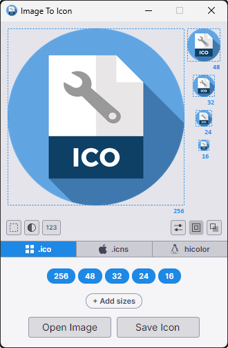
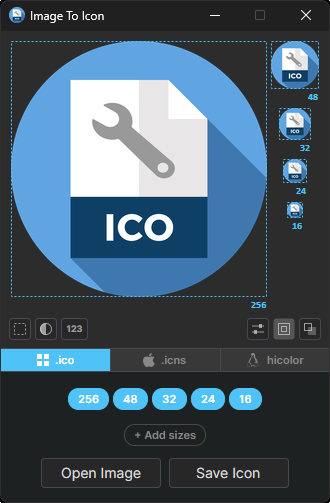
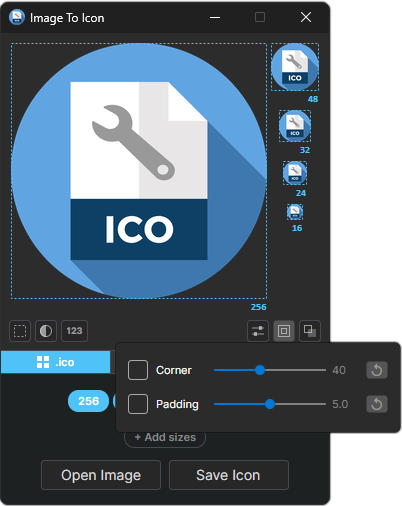
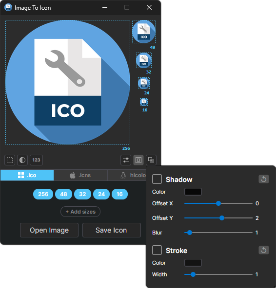
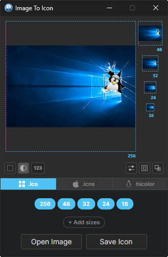
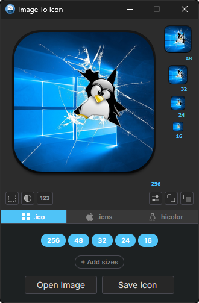
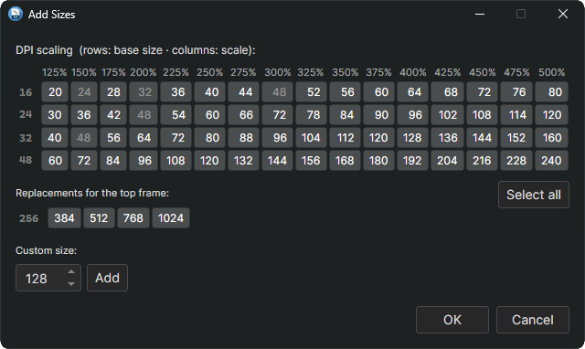
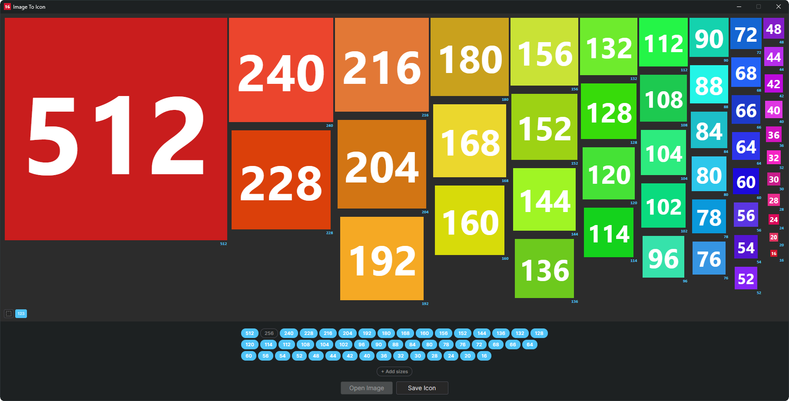

# Screenshots

### Main Window — Light / Dark
 

### Corner & Padding —  Dark

### Shadow & Stroke —  Dark

### Example — Input / Output
 

### Add Sizes Window —  Dark

### Test Mode —  Dark

